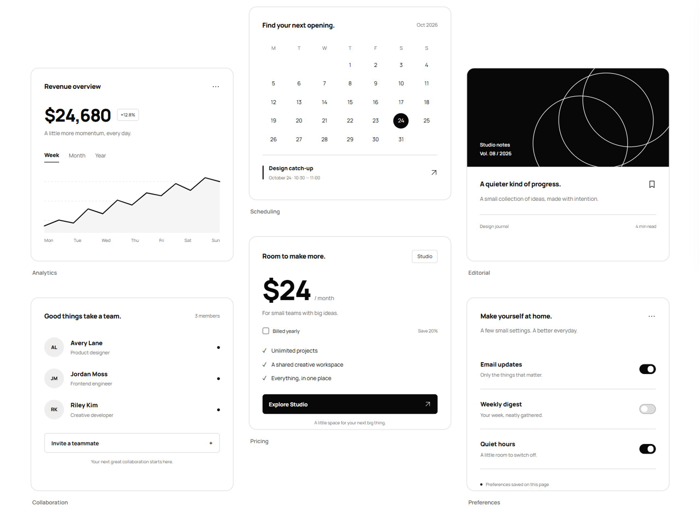
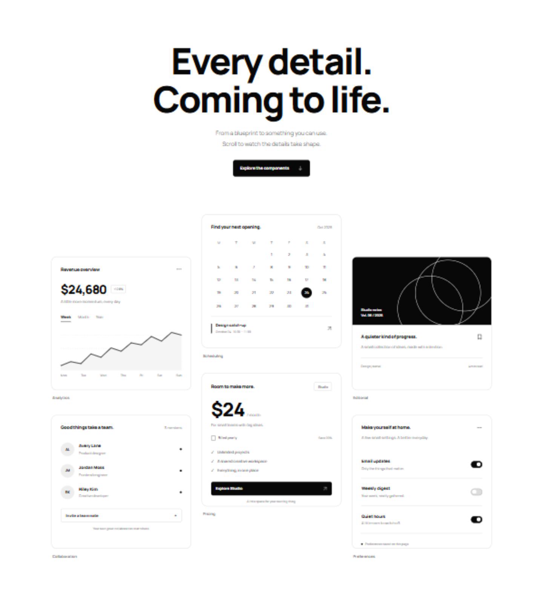
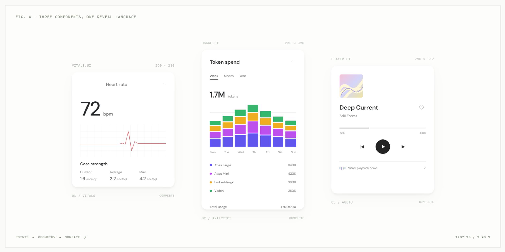
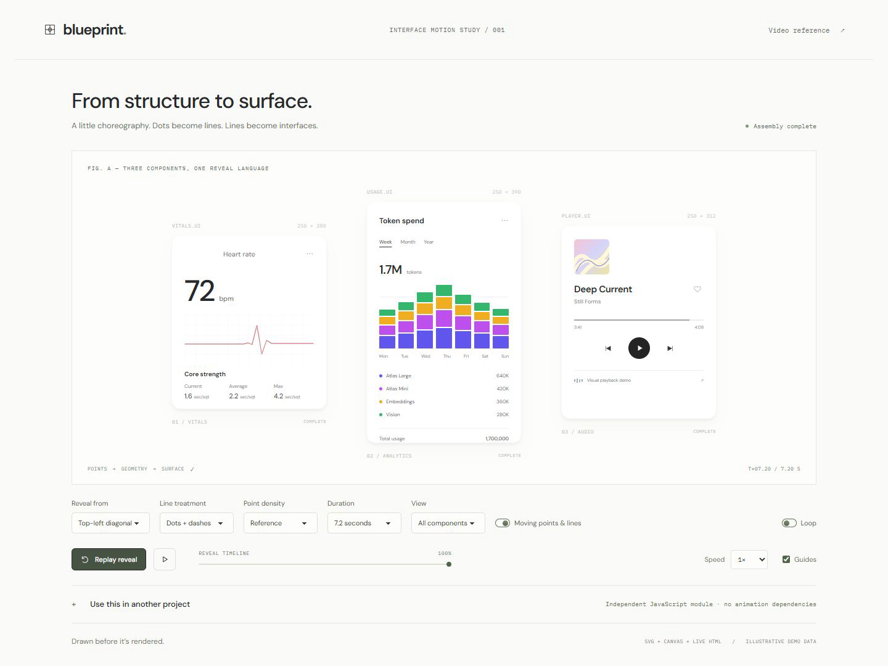

# Blueprint Reveal

**Agent skills for adding moving blueprint-to-UI reveals to existing websites.**

Available for **Codex** and **Claude Code**. Invoke the skill from a web project's root: the agent inspects the source, authors a matching blueprint for each eligible component family, and integrates shared reveal settings with a development controls panel.

The effect moves from drifting dots to traced geometry, then replaces the blueprint with fully opaque, interactive HTML. The same moving boundary reveals the surface and removes construction marks behind it.

## Previews

The players below use the actual **full-quality MP4s at 25 fps**, with the reveal slowed to about **7.2 seconds**, plus short pauses. Download/open links sit beneath each player.

**GitHub rendering:** repository-relative MP4 players work only in Markdown viewers that allow HTML video. For native players on GitHub, upload these MP4s in GitHub's README editor and use the generated attachment URLs. See the [exact GitHub embedding steps](docs/previews.md#native-video-players-on-github).

### Monochrome component gallery

Six interactive components in a staggered three-column gallery.

<video controls playsinline preload="metadata" width="100%" poster="docs/media/monochrome-gallery-poster.png" aria-label="Monochrome gallery reveal video">
  <source src="docs/media/monochrome-gallery.mp4" type="video/mp4">
  Your Markdown viewer does not support this video player. Use the MP4 link below.
</video>

**[Watch the full-quality MP4 — 2560 × 1876, 25 fps](docs/media/monochrome-gallery.mp4)**

<details>
<summary>View still images</summary>





</details>

### Original component demo

The earlier reveal lab: heart-rate widget, token-usage chart, and music-player interface.

<video controls playsinline preload="metadata" width="100%" poster="docs/media/original-demo-poster.png" aria-label="Original component reveal video">
  <source src="docs/media/original-demo.mp4" type="video/mp4">
  Your Markdown viewer does not support this video player. Use the MP4 link below.
</video>

**[Watch the full-quality MP4 — 2464 × 1232, 25 fps](docs/media/original-demo.mp4)**

<details>
<summary>View still images</summary>





</details>

[Optional compact GIFs: gallery](docs/media/monochrome-gallery.gif) · [original demo](docs/media/original-demo.gif)

## Quick start

Prerequisites: Node.js 20 or newer and either Codex or Claude Code. There are no npm dependencies to install, no API keys to configure, and no automatic install hooks.

From this repository's root, preview the installation:

```sh
node scripts/install.mjs --tool both --dry-run
```

Install both personal skills:

```sh
node scripts/install.mjs --tool both
```

Or install just one:

```sh
node scripts/install.mjs --tool codex
node scripts/install.mjs --tool claude-code
```

The installer verifies copied files, treats an identical installation as unchanged, and refuses to overwrite a different existing skill. It does not run Git, publish, edit a project, change tool permissions or install dependencies. A coding tool may request permission to write to its personal skills directory.

Open your actual project's main folder in your coding tool, then run:

**Codex**

```text
$blueprint-reveal
```

**Claude Code**

```text
/blueprint-reveal
```

For an explicit app-wide request:

```text
Apply the reveal across this project, generate matching blueprints for every eligible component, and add shared global settings with development controls.
```

Append a route or component name to narrow the scope. Start a new coding-tool session if the installed command does not appear.

For copy-and-paste clone/install commands after publishing, see [Install from GitHub](docs/install-from-github.md). A local framework test is documented in [Next.js validation](docs/nextjs-validation.md).

## Install locations

| Scope | Codex | Claude Code |
| --- | --- | --- |
| Personal | `$CODEX_HOME/skills/blueprint-reveal` or `~/.codex/skills/blueprint-reveal` | `~/.claude/skills/blueprint-reveal` |
| Project | `.agents/skills/blueprint-reveal` | `.claude/skills/blueprint-reveal` |

Personal installation makes the skill available across your projects. For a project-scoped installation, run this from the skill repository and supply the destination project:

```sh
node scripts/install.mjs --tool both --scope project --project ../my-web-project
```

You can also copy the appropriate `blueprint-reveal/` folder manually. Keep its `assets/`, `references/`, `scripts/`, and license files; `SKILL.md` alone is not enough. Tool discovery policies can vary by installation; follow your tool's configured skills directory when it differs from these defaults.

## What the skill does

1. Inspects the app's framework, routes, component source, layout, icons, charts, and current animation setup.
2. Inventories eligible component families and repeated instances. Each visual region has one owner, avoiding nested duplicate reveals.
3. Generates blueprint factories from measured layout, wrapped text lines, inline SVG geometry, and authored paths where needed.
4. Integrates the runtime with the app's real mount/unmount lifecycle and one shared project controller.
5. Creates persistent global settings and a development panel, then checks representative desktop/mobile states.
6. Records coverage, validation, and concrete exclusions so app-wide requests are not silently reduced to a few sample cards.

This is an agent-assisted integration workflow, not a post-processing build plugin. The coding agent must read and modify your project. The scaffold script only copies assets; it does not generate all component blueprints or finish integration on its own.

## Files added to a web project

| File or location | Purpose |
| --- | --- |
| `src/blueprint-reveal/` or the app's equivalent | Dependency-free animation engine, geometry helpers, controller and optional controls |
| `blueprint-reveal.config.js` | One source for global defaults and group/component overrides |
| `blueprint-reveal.blueprints.js` | Layout-aware factories for that project's component families |
| `blueprint-reveal.coverage.md` | Implemented targets, checks, limitations and exclusions |

The agent adapts paths or uses equivalent typed modules when the host framework requires it. Existing settings and blueprints must be preserved on later invocations.

### Shared options

| Setting | Values / behavior |
| --- | --- |
| Reveal direction | Top-left diagonal, top, left, bottom, right, bottom-right diagonal, center outward |
| Line treatment | Dots + dashes, dotted, drafting lines |
| Point density | Sample spacing in pixels; smaller spacing creates more points |
| Duration and speed | Duration in milliseconds; speed adjusts playback rate |
| Guides | Show/hide moving construction cursors |
| Movement | Enable/disable drifting points, moving strokes and tracing heads |
| Enabled | Globally enable or disable the effect |
| Playback | Visible/load/manual trigger, bounded stagger, once/repeat and optional looping |
| Overrides | Persistent per-group and per-component settings |

The development panel includes live global controls, replay, pause, reset and timeline inspection. It is hidden in production by default. Panel changes are temporary: use **Copy current defaults**, then paste them into the shared config to make them persistent. The browser does not silently rewrite source files.

## Try the example

```sh
npm run demo
```

Open [the local demo](http://127.0.0.1:4175/) and expand **Blueprint reveal controls**. The example uses a measured SVG chart and wrapped text, both driven by the shared controller. Its original button remains a live HTML button after the reveal. Stop the server with Ctrl+C.

The runtime and developer tools have no network dependencies. The optional example loads daisyUI and Tailwind from public CDN URLs for styling; see [NOTICE.md](NOTICE.md). No original third-party reference video, screenshot, personal dataset or audio file is included. The README previews are captures of our own local demos, with illustrative data.

## Viewport activation

Version 0.2.0 changes the default activation timing; see [CHANGELOG.md](CHANGELOG.md). Existing projects must deliberately merge the updated runtime and playback settings, preserving their authored blueprints and config. Updating the installed skill alone does not rewrite websites that already use it.

Components start revealing when they enter the middle 20% of the screen. Configure this centrally:

```js
playback: {
  trigger: 'visible',
  activation: 'center',
  viewportBand: 0.2,
  threshold: 0,
  once: true,
  stagger: 70,
  maxStagger: 280
}
```

`viewportBand` controls the height of the central activation zone. Use `activation: 'viewport'` for an earlier entrance at the screen edge. This setting is independent of the reveal direction. Explicit Replay starts visible components immediately; timeline inspection stays paused during scrolling and resizing.

## Improvements from the Next.js test

Both packages now include [tested React/Next.js integration guidance](codex/blueprint-reveal/references/react-next.md): separate framework content and animation mounts, cancel asynchronous registration on cleanup, refresh changing content even at fixed sizes, crop authored geometry to real overflow boundaries, and verify development tools stay out of production. See [validation results and limits](docs/nextjs-validation.md).

## Supported integrations and limits

The browser runtime uses standard DOM, SVG and canvas APIs. The skills include integration guidance for static HTML, React/Next.js, Vue, Svelte and routed/static-island apps. An agent must adapt and verify the implementation in the actual host; this repository does not claim every framework or browser combination has been tested.

The helpers measure real bounds, text wrapping and inline SVG paths. They do not reconstruct photographic edges, exact font outlines, inaccessible shadow roots, cross-origin iframe internals or arbitrary WebGL/canvas scenes. Those need source-known geometry or an explicitly reported fallback. A matching authored blueprint is more accurate than a generic bounding box.

Reduced-motion playback shows completed content immediately. Content stays visible before initialization and when JavaScript is unavailable. Nonessential loops stop when hidden/offscreen. Incomplete content is inert during revealing, so the effect should run on entrance rather than interrupt an active form or focused control.

The implementation uses complementary masks, not a slow crossfade with construction marks over finished content. Keep this behavior when modifying the runtime.

## Repository layout

```text
codex/blueprint-reveal/        Codex skill and its bundled assets
claude-code/blueprint-reveal/  Claude Code skill and the same shared assets
scripts/                     Portable installer, validation, audit and demo server
tests/                       Runtime, installer and publication checks
examples/demo/               Small browser integration example
docs/                        Release review and validation notes
.github/workflows/           Read-only CI checks for Windows and Linux
```

## Validate before sharing changes

```sh
npm run check
npm test
npm run audit:release
```

No `npm install` is required. Checks validate skill structure, relative references, shared-package parity, module imports and the publication audit. Tests cover safe scaffolding, installer behavior, configuration resolution, clipping directions and secret-pattern detection. GitHub Actions is configured to run these checks; its first hosted run occurs after you push.

The audit reports rule names and file locations without printing matched values. It is a guardrail, not proof that arbitrary future content is secret-free. See [SECURITY.md](SECURITY.md) and the [initial release review](docs/release-review.md).

## Publish this repository

Publish **this folder only**, not its parent workspace. It contains the complete source, documentation, tests and license, and no remote repository or account identity is preconfigured. You can create an empty GitHub repository and upload this folder's contents, or initialize a local repository and push it using your normal Git workflow. No npm publication is needed to distribute these skills.

## License

[MIT](LICENSE), copyright 2026 Moazam Ali. Preserve the license when redistributing the skills or copying the bundled runtime into another project. The effect is independently implemented; no third-party source or reference media is redistributed. See [NOTICE.md](NOTICE.md).
